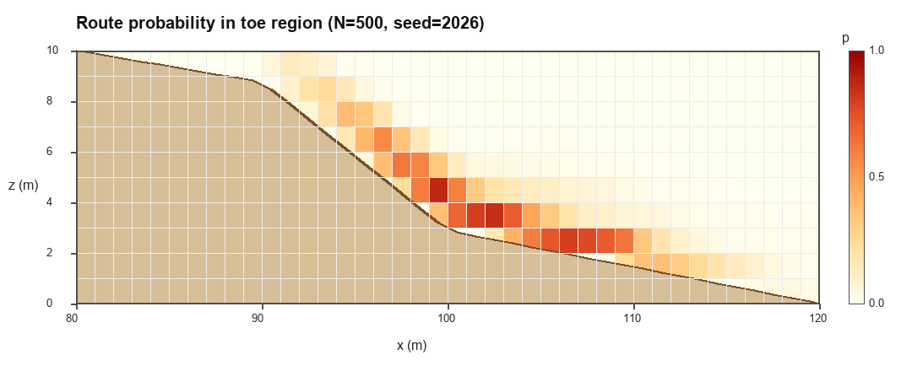

# 批量蒙特卡洛统计与 CSV 输出（任务 1、2）

本 PR 在现有的**凸多边形刚体**版本上增加了无窗口的批量模拟模式：

1. **任务 1**：随机模拟若干次，统计坡脚 10 m 高度范围内几何体的路线概率；
2. **任务 2**：把逐次结果、概率网格和总体统计输出为 CSV，便于后期分析。

原有的图形界面、`--self-test` 和物理模型都没有改动；批量模式只是复用
`RollingStone::update()`，把“按键 → 单次演示”换成“循环 → 统计”。

---

## 1. 运行方法

### 1.1 图形模式（原程序）

```text
rollingstone.exe
```

### 1.2 回归自检（原程序）

```text
rollingstone.exe --self-test
```

### 1.3 批量模式（本 PR 新增）

```text
rollingstone.exe --batch 500 2026
```

- `--batch`（或 `-b`）：进入批量模式，不打开图形窗口；
- `500`：模拟次数；
- `2026`：随机种子，便于复现；写 `0` 表示用当前时间。

CSV 会写到**当前工作目录**。在 Visual Studio 里运行时，可以在
“项目属性 → 调试 → 命令参数”填 `--batch 500 2026`，输出通常落在项目目录。

---

## 2. 批量场景与随机模型

### 2.1 为什么释放点不在坡顶

默认图形模式从坡顶（x=0）以 1.5 m/s 释放。对**多边形块体**来说，地形最上面
10 m 只有约 20°，摩擦系数 0.45 足以让它停住；x=30~40 m 的 7° 缓台也会截住它。
如果批量也从坡顶释放，绝大多数样本到不了坡脚，坡脚概率没有统计意义。

因此批量场景把释放点放在**坡脚上方的 30° 陡坡段**（x=90~100 m），并给一个
“已经加速”的初速度。这是一个明确的模拟场景选择，不是对 GUI 默认值的修改。
如果要改回坡顶释放，改 `batch_stats.h` 里的 `ux(...)` 和 `nV0(...)` 即可。

### 2.2 随机抽样（CV = 0.1）

| 变量 | 含义 | 分布 | 范围 |
|---|---|---|---|
| `x0` | 释放点水平位置 | U(90, 100) m | 90 ~ 100 m |
| `v0` | 顺坡初速度 | N(10.0, 1.0) m/s | 0 ~ 20 m/s |
| `r` | 外接圆半径 | N(2.0, 0.20) m | 0.5 ~ 3.0 m |
| `S` | 截面积 | N(3.0, 0.30) m² | `[1e-4 r², 0.95·maxArea(3,r)]` |
| `mu` | 摩擦系数 | N(0.45, 0.045) | 0.05 ~ 1.0 |
| `e` | 恢复系数 | N(0.45, 0.045) | 0 ~ 0.9 |
| `Cd` | 空气阻力系数 | N(1.0, 0.10) | 0 ~ 2.0 |
| `c_rr` | 滚动阻力系数 | N(0.02, 0.002) | 0 ~ 0.3 |

每次模拟的边数 `k` 在 `[3, 6]` 内均匀随机，顶点由原程序的
`generatePolygon(ShapeSettings, rng)` 按“定面积圆内接凸多边形”采样生成。
所以同一组 `(r, S)` 也会得到不同的形状（三角形、四边形、五边形、六边形）。

---

## 3. 统计口径

### 3.1 坡脚 10 m 高度范围

程序扫描地形，找到地面高程 `z = 10 m` 的等高线；本地形在 **x = 80 m**。
分析区为：

```text
x ∈ [80, 120] m，z ∈ [0, 10] m
```

### 3.2 路线概率网格

- 1 m × 1 m 网格，共 40 × 10 = 400 格；
- 每个物理步（2 ms）记录一次**质心**位置；
- `hit_trials`：有几次模拟的质心轨迹至少经过该格一次；
- `p_all = hit_trials / 总次数`；
- `p_entered = hit_trials / 进入坡脚区的次数`。

`p_all` 是**占用概率**，不是互斥概率：一次模拟会经过多个格子，所以所有格子的
`p_all` 之和不等于 1。若要得到空间分布密度，可自行用 `p_all` 除以总和。

### 3.3 虚拟收集器

在坡脚平台 `x = 110 m` 处设一个虚拟的“数据收集器”平面，用线性插值求
质心穿过该平面时的高度 `collector_z`，按 1 m 分层统计 0~10 m 的高度分布。
选择 x=110 而不是坡底 x=120，是因为块体在 8° 坡脚平台上会逐渐停住，
x=110 仍属于坡脚平台且能获得足够样本。

### 3.4 状态定义

| 字段 | 含义 |
|---|---|
| `entered_toe` | 质心是否进入过 `z ≤ 10 m` 的坡脚区 |
| `reached_collector` | 是否穿过 `x = 110 m` 的收集器平面 |
| `collected_in_10m` | 穿过收集器时质心高度是否在 0~10 m |
| `reached_end` | 是否到达 `x = 120 m` 的坡脚边界 |
| `stopped` | 是否在到达坡脚边界前停住 |
| `timed_out` | 是否到 30 s 仍未停 |
| `failed` | 物理求解或形状生成是否抛异常（失败样本不计入概率网格） |

---

## 4. 输出文件

| 文件 | 内容 |
|---|---|
| `results/batch_trials.csv` | 每次模拟一行：抽样参数、形状边数/面积、最终位置、最大速度、路径长度、各状态 |
| `results/route_probability_grid.csv` | 坡脚区 2D 路线概率网格（400 行） |
| `results/route_profile_x.csv` | 沿 x 方向的 1D 路线概率（40 行） |
| `results/impact_height_at_toe.csv` | 虚拟收集器高度分布（0~10 m，10 层） |
| `results/trajectories_toe.csv` | 坡脚区内每 0.05 s 采样的质心轨迹 |
| `results/batch_summary.csv` | 总体统计（计数、均值、标准差） |
| `results/route_probability_heatmap.png` | 由上述 CSV 绘制的概率热图 |

### 4.1 `batch_trials.csv` 主要列

| 列 | 含义 |
|---|---|
| `trial` | 第几次模拟（0 开始） |
| `x0, ground_z0` | 释放点 x 和该处地面高程（m） |
| `v0` | 初速度（m/s） |
| `radius, area, sides` | 外接圆半径、截面积、实际边数 |
| `mu, e, cd, crr` | 本次使用的摩擦/恢复/空气阻力/滚动阻力系数 |
| `final_x, final_z` | 结束时质心位置（m） |
| `final_speed, max_speed` | 结束速度、全程最大速度（m/s） |
| `max_height` | 全程最大质心高度（m） |
| `sim_time` | 模拟时长（s） |
| `collector_time, collector_z` | 穿过 x=110 m 的时间和质心高度；未穿过为 -1 |
| `path_length` | 质心轨迹总长度（m） |
| `toe_entry_time` | 首次进入坡脚区的时间（s）；未进入为 -1 |
| `failed, error` | 是否失败及错误信息（成功时为 `ok`） |

### 4.2 概率网格列

`x_min, x_max, z_min, z_max, center_x, center_z, ground_z, hit_trials, p_all, p_entered`

`ground_z` 是格子中心处的地面高程，便于区分“地下格子”和“地上格子”。

---

## 5. 样例结果（N = 500，seed = 2026）

```text
坡脚区：x ∈ [80, 120] m，z ∈ [0, 10] m
进入坡脚区：500 / 500（100.0%）
到达 x=110 收集器：303 / 500（60.6%）
收集器 0~10 m 内：303 / 500（60.6%）
到达坡脚边界：16 / 500（3.2%）
中途停住：484 / 500（96.8%）
超时：0
失败：0

平均最终 x：111.25 m（标准差 3.60）
平均最终 z：1.90 m（标准差 0.54）
平均最大速度：11.53 m/s（标准差 1.30）
平均路径长度：17.64 m（标准差 5.14）
平均模拟时长：5.35 s（标准差 0.86）
```

路线网格：400 格中 **123 格**被经过，且这 123 格的 `p_all` 全部在 0 和 1 之间，
范围 **0.002 ~ 0.87**。没有“100% 必经”的格子，说明多边形形状和参数随机性
确实让路线产生了分散，而不是一条固定轨迹。

收集器高度分布：

| 高度层 | 命中次数 | `p_all` | 条件概率 |
|---|---|---|---|
| 1 ~ 2 m | 110 | 22.0% | 36.3% |
| 2 ~ 3 m | 159 | 31.8% | 52.5% |
| 3 ~ 4 m | 24 | 4.8% | 7.9% |
| 4 ~ 5 m | 10 | 2.0% | 3.3% |
| 其他层 | 0 | 0% | 0% |

> 条件概率的分母是“收集器 0~10 m 内的 303 次命中”。



图中横轴是 x，纵轴是 z，颜色越深表示 `p_all` 越大；棕色区域是地面以下。
概率带从 x≈90 m 的 30° 陡坡段开始，在 x≈100~105 m 达到最高，然后向坡脚
逐渐变宽、变淡，反映了块体在坡脚平台上的减速和停止位置差异。

---

## 6. 说明与限制

1. **轨迹取质心**。多边形有实际大小，质心不代表最低点；若要按最低点统计，
   可在 `trajectories_toe.csv` 的基础上减去局部半径（近似）。
2. **批量场景是单独的统计场景**：释放点 x=90~100 m、初速度均值 10 m/s。
   GUI 仍然从坡顶以 1.5 m/s 释放，二者不冲突；批量场景只是为了在合理时间内
   获得坡脚样本。
3. **失败样本**会被记录在 `batch_trials.csv` 中，但不会计入概率网格和均值；
   本次 500 次没有失败样本。
4. 单次模拟最长时间 30 s；超过则记为 `timed_out`，防止异常参数导致死循环。
5. CSV 是 ASCII 表头 + 数字，Excel、pandas、MATLAB 都可直接读取。
6. `--self-test` 仍通过：300 个随机几何 + 1100 个 `10 20 7 20` 样本 +
   斜面/自由落体/恢复系数/穿透等回归检查；上游新增的弹性挡板自检也通过。
