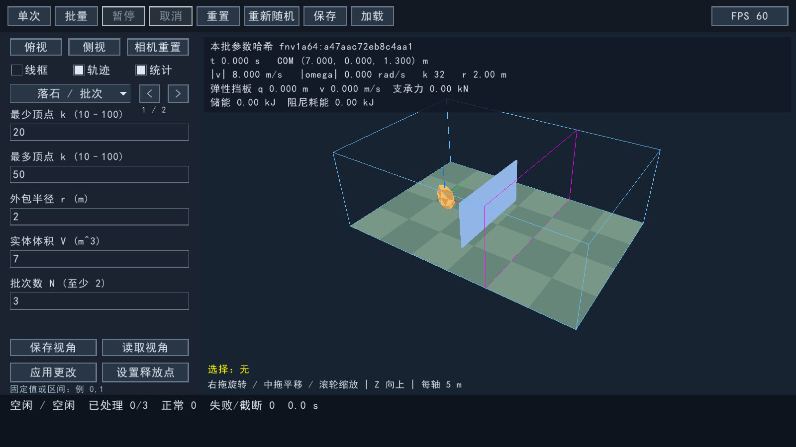

# 三维弹性挡板

2026-11-12 用户要求补齐二维版已有的弹性挡板。此次追加允许超出原三维首版只含静态挡板的范围；原 IMPLEMENTATION_PLAN.md 和二维源码未改写。

## 启动与操作

```powershell
./run_elastic_3d.cmd
```

该入口现在默认打开 `configs3d/parameterized_elastic.ini`：55.6m 参数化坡面、坡脚自动定位的36m宽/8m高弹性挡板，M=2000kg、k=500000N/m、c=30000N·s/m。板中心x=`auto`（坡面终点前10m），z=`auto`（按实际地形支撑高度放置）；修改坡面后继续自动定位。地面摩擦0.2、恢复系数0.15是该演示的明确输入，均可编辑。

原平地演示保留为 `run_elastic_3d.cmd --config configs3d/elastic_barrier.ini`。切换地形并成功应用时，相机自动调整到新地形的完整视野；其他参数修改保留视角。

点击“单次”观看当前落石撞击、板后退和回弹；点击“批量”先显示两次真实预览，再后台计算余下试验。左侧“挡板”组第一页面可设置 enabled=true、mode=elastic、质量 M、刚度 k 和阻尼 c，点“应用更改”生效。mode=rigid 恢复静态挡板，enabled=false 关闭挡板。旧 INI 不含 mode 时仍按 rigid 读取。参数修改、保存/加载、运行锁定、暂停/继续和取消规则与其他场景参数相同。

弹性模式在视口顶部显示实际位移 q、法向速度、支承力、弹簧储能和阻尼耗能。显示和拾取使用每步实际 Jolt 板位姿，不能用原固定中心替代。中心坐标是弹簧零位，initial_displacement 和 initial_velocity 是开始时的轴向位移与速度；auto 只决定零位的初始支撑高度。

| 参数 | 单位 | 接受范围 | 默认值 |
| --- | --- | --- | --- |
| mass | kg | 1–10^7 | 2000 |
| stiffness | N/m | 0–10^8 | 500000 |
| damping | N·s/m | 0–10^7 | 30000 |
| initial_displacement | m | -100–100 | 0 |
| initial_velocity | m/s | -100–100 | 0 |

这些数值范围是程序输入边界，不表示任意组合都是已经标定的工程挡板。宽、高、厚度、绕 Z 方位角和摩擦仍控制同一个有限尺寸碰撞体。elastic 模式接触恢复系数固定为 0，回弹由弹簧释放能量产生，避免恢复系数与弹簧重复计入弹性；界面 e 字段只对 rigid 模式生效。



## 物理模型与数值方法

模型承接二维版的一自由度质量—弹簧—阻尼板。板本身保持刚性，沿水平法线 n=(cos(yaw),sin(yaw),0) 平移，中心 C=C0+q*n，导轨约束横向、竖直和转动自由度。支架承担重量；挡板不受重力、不与地形进行碰撞。石块仍有完整三维平动和转动，偏心碰撞会产生落石转矩，落石与有限板的接触由 Jolt 求解。

连续轴向方程为 M*q'' + c*q' + k*q = F_contact。每个实际碰撞子步 h 采用隐式支承，消去弹簧与阻尼后得到：

```
M_eff = M + h*c + h*h*k
v_free = (M*v_old - h*k*q_old) / M_eff
M_eff*v_next = M*v_old - h*k*q_old + J_contact
```

在 Jolt 接触求解前设置该子步的等效接触质量及自由速度，接触冲量同时反馈给落石和板；物理质量和动能仍使用 M；引擎质量与逆质量按 Jolt 的 float 精度实际存储，输出审计单独容许此舍入。导轨使用 SliderConstraint，不使用目标速度伺服或预设动画。固定逻辑步 0.002s、每步 4 个碰撞子步保持不变。

弹性场景使用 80 次速度迭代、0.05m 预测接触距离并关闭约束热启动。边界试验显示默认 10 次迭代或保留热启动会在小板质量/大刚度时超过既定穿透或能量门槛。刚性/关闭模式仍用原 10 次迭代、0.02m、热启动开启；位置迭代 2、CCD 阈值 0.25 不变。预测距离不改变板几何尺寸；进入此邻域不代表已经发生实体穿透。

停止条件同时要求石块满足原静止判据、且 sqrt(v^2+k*q^2/M)<0.02m/s 持续 2s，避免在回弹转折点提前停止。k=0 时允许板停在新的位置；c=0 时可持续振荡并达到时间上限。石块退出吸收边界仍立即结束该试验，输出是此时的板状态，不继续统计板的后续自由振动。

## 输出与回放

新增 barrier_trajectory.csv 与 barrier_trials.csv。前者和落石轨迹同频采样，trajectory_stride=0 时只有表头；后者每个已开始 trial 都有一行，has_state=0 表示没有成功创建物理状态。失败/超时/取消仍保留原槽位及原概率分母规则。

- displacement_m / velocity_m_s：带符号轴向位移和速度。
- support_force_N=k*q+c*v：支承反力表达值，作用在板上的力为 -support_force_N*n。
- contact_force_step_average_N：完整逻辑步内净轴向接触冲量除以逻辑步长。
- peak_abs_contact_substep_average_N：截至当前的最大子步平均轴向接触力绝对值，**不是瞬时冲击峰值**，不含导轨横向反力。
- contact_impulse_Ns：累计带符号轴向接触冲量。
- kinetic_J=0.5*M*v^2，spring_J=0.5*k*q^2。
- damper_loss_J：累计 h*c*v_next^2，非负并单调增加。
- support_work_residual_J：用实际支承冲量和速度、位移读回计算的有符号功量残差。它包括积分、接触耦合和位置修正影响；**不能加到物理阻尼耗能中解释为材料吸能**。
- max_abs_displacement_m / peak_abs_support_N：累计最大绝对位移及支承力。

manifest 记录模型版本、积分形式及实际求解器设置。重放读取实际顶点/面、初态、场景参数和地形，不重新随机落石；新输出还验证板的位姿、位移、速度、力、能量、冲量和历史最大值。旧输出没有挡板附加文件时继续校验原落石状态，旧刚性配置哈希保持兼容。

结果目录提交遇到Windows短时占用（错误5/32）时，最多尝试4次，等待10/20/40ms；持续失败仍保留.pending与INCOMPLETE、清空正式概率并报告I/O错误，不重新随机或丢弃试验槽位。

## 验证边界

验证区分源代码核对、数值运行、实际图形进程与原生交互。实测记录追加于 VALIDATION.md。新增 rs3d_elastic_tests 包含解析阻尼振子、有限质量碰撞及动量、绕 Z 导轨、偏心转矩/有限边缘、零刚度/零阻尼、27 个参数边界高速碰撞，以及时间步细化。完整运行还覆盖弹性批量/预览一致性、暂停/取消、输出审计和回放。

本功能是带弹簧阻尼支承的刚性板，不是可弯曲网片、连续介质有限元、断裂或失效模型。没有凭数值自检宣称材料已经过实验标定。
