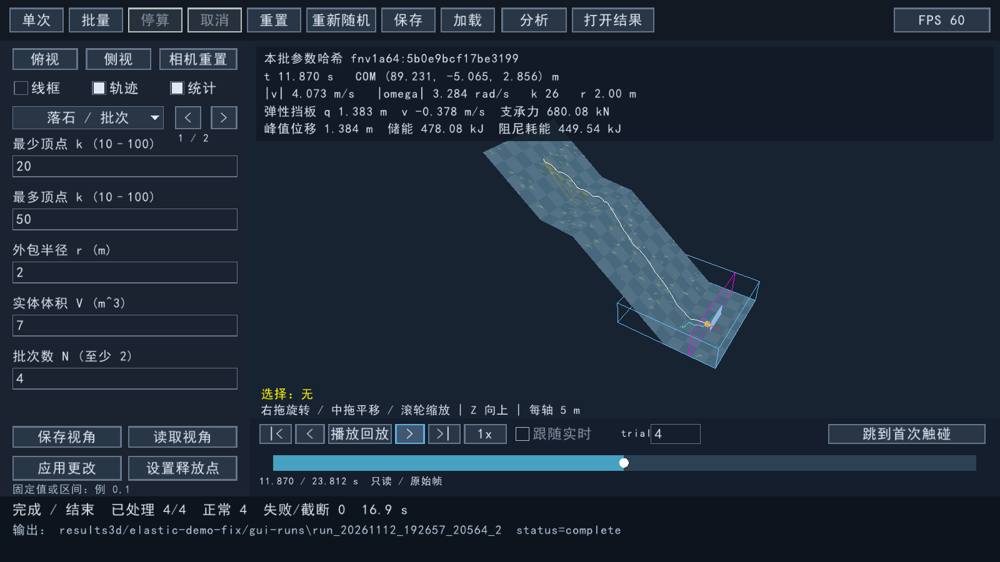

# 组合演示的弹性挡板修复

2026-11-12，用户指出当前演示挡板没有弹性位移。基线HEAD为c09cf45416843b0ee168e6ba0540a845455f713f。

## 原因与修复

`run_obstacles_3d.cmd` 加载的 `obstacles_heatmap_timeline.ini` 只设置 enabled=true，遗漏 mode。为兼容旧配置，程序把它加载成rigid，挡板固定、位移始终为0。修复前用实际可执行程序展开配置，得到 `mode=rigid`；新增直接加载该随附预设的回归也明确失败。

组合预设现显式设置 elastic、M=2000kg、k=500000N/m、c=30000N·s/m、初始位移和速度0、接触e=0。保留原10m宽/5m高挡板、滚石/地形/释放条件、主seed和碎石设置。旧INI缺少mode仍加载成rigid。没有修改求解器或添加摆动动画。

窗口现在明确显示刚性/弹性模式。弹性普通帧同时显示q与截至当前时刻的峰值位移，避免回弹到零位后误判“从未移动”。首次接触事件不显示未保存的普通帧力学值。固定障碍提示移到状态区下方，避免遮住位移。

## 实际结果

原组合预设同一主seed，N=10实际完整求解：10次均正常完成。第1、2、3、6、7、8、9次未触板；第4、5、10次触板，最大绝对位移分别为1.38414405224m、2.57966433463m、2.24042241052m。仅描述这10次记录，不把它当作稳定概率或工程材料标定。

第4次约11.87s的原始记录帧显示q=1.383m、峰值1.384m；23.812s停止时q约8.38×10⁻¹³m、峰值仍为1.384m。板沿法向整体平移并回弹，不是板材弯曲变形。

真实GUI把N从3改为4并应用，前两次实时预览后完成全部4次。其4行最终挡板状态与无窗口N=10的前4行逐字段完全一致。手动选择trial 4、拖动时间轴并切到原始记录帧，观察到上述位移；跳末帧验证回弹后峰值仍保留。GUI前两次未触板，不改随机顺序来制造预览命中。

第4次从保存结果重新积分：落石位置和挡板位置误差均为0。N=10档案共15580帧，只读打开的物理更新次数为0。Release全套19/19通过，包括新随附组合预设回归，以及原弹簧阻尼数值、碰撞、观测器、档案与回放回归；组合预设回归完整运行到第4次停止，峰值1.38414405224m。

Debug的配置兼容、弹性数值与实际组合预设3/3通过。三份原有工作区修改按基线SHA256保持不变，Jolt/raylib/raygui缓存均干净。

原碎石修复的100次三组对照使用刚性挡板，保留历史数值并明确标注，不能用作当前弹性预设的结果。证据位于 [evidence/elastic-demo-fix](evidence/elastic-demo-fix/summary.json)。
