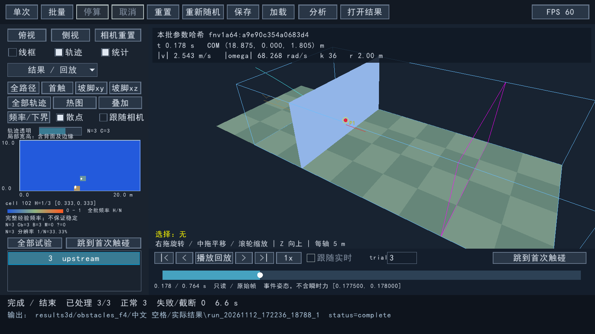
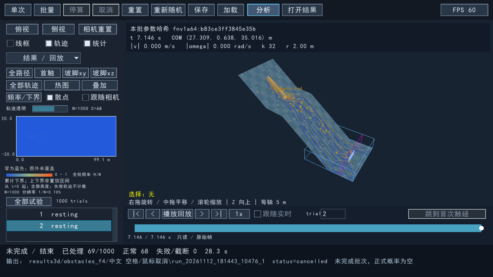

# 固定障碍、热图与时间轴验收记录

2026-11-12。按 `OBSTACLES_HEATMAP_TIMELINE_PLAN.md` 全文及第11节执行；本文记录实际运行证据，不以界面截图代替求解验证。原始日志及完整档案在仓库 `results3d/obstacles_f0` 至 `obstacles_f5`；可随源码和程序包查阅的精简证据在 [evidence/obstacles](evidence/obstacles/summary.json)。

## 基线与构建身份

- 实际起始 HEAD：`73550f624f1975808905081150eff0838a8051a4`；已提交弹性挡板为 `3cd17d4`。采样器保持 `convex-retreat-com-radius-v3`：r 是实体质心至最远顶点的距离，其他顶点允许在球内。
- 原有 `RollingStone.sln`、`docs/3d/IMPLEMENTATION_PLAN.md` 和读取时已修改的合同文件均按原字节保留，不纳入本任务提交。初始 SHA256、原件和 diff 保存在 `results3d/obstacles_f0`，观测审计再次核验。
- 使用现有 VS2022 Enterprise / MSVC 19.44.35228、x64、/MT 和 Debug /MTd，未安装编译器或升级依赖。Jolt/raylib/raygui 固定 SHA 见 [DEPENDENCIES](DEPENDENCIES.md)。
- 最终程序在唯一提交之前构建，因此 manifest 的 `source_head` 记录上述起始 HEAD；`source_tree_sha256` 标识实际三维源码内容，不能把起始 HEAD 误当最终内容。补丁与生成文件另有完整 hash；程序包以 `package-sha256.json` 标识实际二进制。

## 阶段与逐项验收

F0 的真实接触观测及三方数值对照先通过，再实施 F1 容量和障碍；随后接入 F2 记录/统计、F3 全批显示、F4 只读时间轴，F5 进行回归、窗口和性能交付。所有工作由一个 agent 执行。

| 条款 | 证据与结果 |
| --- | --- |
| O1 | `rs3d_obstacle_tests`：N=2/3/1000、preview=0/2，逐 trial 读回全部实际 Jolt 障碍变换/材料；重启和实际几何重载 hash 相同，含 seed=0 |
| O2 | 同主 seed 开关障碍及改障碍 seed，落石几何、物性和初态不变；旧配置缺项为 disabled，原物理/批量回归通过 |
| O3 | 实际旋转足迹与地形三角片精确裁剪；跨折点/横坡/沟槽、仅边交点极值、共线/零面积、保留区、边界和距离用例；拥挤明确失败，不少放 |
| O4 | 50m/s 正撞/斜撞反弹、越顶、侧过及较大障碍低速停靠；静态变换不变；对称材料表、障碍—弹性挡板过滤和支座冲量隔离通过 |
| O5 | 0/40/500 障碍构造及真实 Update；不足容量注入失败。500 个时 bodies=508、pairs=8128、contacts=16256，临时池41,680,896B、观测峰值14,270,833B，无溢出。默认组合演示100次正常、95次碰障碍、8次触板 |
| H1 | 手工 DDA 跨格/边角/往返/驻留，t=0及空中段、不同高度同xy、坡脚区以外均按 trial 去重 |
| H2 | N4/C2/H1 的精确列空、范围[.25,.75]；完整N4/H2=.5。改变记录间隔与开关不改变整数计数 |
| H3 | N2/3/1000 的目录与轨迹 ID、首尾全保留；30,001点长轨迹保留重要转折及取消状态，百万级显示预算不删 trial；真实 GUI 第3次后台轨迹出现 |
| H4 | 真实窗口日志从1条、2条追加至3条及100条；全路径/首触格与 CSV 核对。取消的69条已知轨迹与1000项目录均可查看 |
| C1 | 最早完整子步归并全部点、稳定排序/去重，持续或再次反弹不重计；交换候选顺序结果相同，非目标接触排除 |
| C2 | 中心/边界/角/不足一格外边界、偏航/平移/弹性运动的事件姿态换算；世界/局部反算，背面/边缘分类及越界拒绝 |
| C3 | 预测擦过无命中、撤销CCD排除；真实高速刚性和弹性正间隙响应确认。更早观测丢失时保留未知；dt=.002/.001 对照区间 .0275:.028 与 .0275:.02775，不宣称轨迹相同 |
| C4 | N10/B4/H3,1：全批.3/.1、条件.75/.25；Cb6/B4/M2 时范围[.3,.7]且精确列空。N2/100/300允许经验频率；禁用/B0/未知/取消分开 |
| C5 | 事件及所有原始点重载复算网格；stride=0也保存事件；无点字段留空，旧结果显示未记录；损坏姿态/局部点拒绝 |
| C6 | 原生窗口点cell102→仅列trial3→跳[.177500000071,.178000000095]并显示原始点P1及双方姿态；拖动/跳转物理计数均3656，重开独立进程播放时计数0 |
| C7 | 七个真实夹具覆盖六类要求，另有CCD撤销夹具；普通与CCD均有观测。无补丁/关闭/开启的运动及整数统计 trace SHA256 都是 `fe32c18f505e017de0ecc1dce226daa29cb7ceb23eecc57f1248618fb2854d13` |
| R1 | 逐 trial t=0、最终有效帧及接触变化前后帧；时间严格递增。显式308B编码、分块校验和，源帧/重载数值一致，动态挡板同步 |
| R2 | 截断/偏移/校验失败和缺必需表拒绝；schema1/2实际CSV、缺历史和缺动态挡板分支；130顶点/256面实际几何可读，不套用采样器k≤100。注册表25文件及marker/rename逐项失败注入通过 |
| R3 | 原帧/首末帧/单帧/零时长、q与−q、近180°最短弧、倒拖/切trial/过时请求丢弃；缓存及动态挡板同一时间对齐 |
| R4 | 真实GUI preview2 与 headless preview0：20份CSV逐字节相同，全部非耗时试验字段及逐trial有序运动帧相同；块发布边界可随预览节奏变化。记录开/关100次对照一致 |
| U1 | 原生窗口文本/相机/时间轴分区，滚轮缩放及拖动；计算暂停期间历史仍播放且Update固定298671，续算继续。前2次跟随可用，后台日志显式禁用并保留trial2。实际输入路由和时间轴捕获函数单测覆盖拖出释放、焦点丢失、短点击、无历史 |
| U2 | 原生窗口启用障碍→应用→N3两次预览→3条路径→选trial3拖动→首触热格筛选/跳转→关闭并重开；另经原生文件选择框打开中文/空格目录。后台鼠标取消确认63.88ms，完整保存68个正常trial及第69个取消片段，未开始931项 |
| P1 | 两份1000×60秒合成档案显式100Hz/auto50Hz，所有trial被选择并读块、所有首尾保留；实际文件/缓存/响应数据见下表及原始日志 |
| P2 | 当前构建四组实际100次障碍开/关×历史开/关，分别记录生成/物理/记录/统计/输出时间和内存/磁盘；全100轨迹+热图真实窗口3轮帧时间；Release/Debug现有18项回归通过 |

## C7 的真实观测与未知边界

`solver-observer-v1` 只在最终 lambda 存储及实际 CCD 响应/撤销分支复制记录。刚性高恢复夹具普通约束4点、正间隙约.012m、最大法向冲量59375N·s；弹性夹具有1872个普通约束观测、最大9128.664N·s，均得到确认首触。擦过夹具1402候选、0确认；撤销夹具4次撤销、4次实际CCD响应。0.1×/1×/10×阈值下各夹具确认数相同，未靠增大slop取得命中。

观测缺失、缓冲溢出及阈值边界仍进入未知；不能据此把普通高速命中全部降级。确认时间只承诺子步区间；正间隙的数值响应不代表表面零间隙。多点算术代表位置只用于唯一格，原始点另存；该图不是力、能量或停留时间热图。

## 性能测量与卡顿修复

目标机器 Intel Core i7-14650HX，16核/24逻辑处理器，物理内存16,877,125,632B；Windows、现有Release x64。P1/P2顺序运行，测量期间不并行构建或其他数值测试。

| P1 档案 | 帧数 | motion.bin实测字节 | 解码缓存峰值 | 索引字节 | 首选块P95 / 最大 | 缓存命中P95 |
| --- | ---: | ---: | ---: | ---: | --- | --- |
| 显式100Hz | 6,001,000 | 1,849,268,024 | 123,121,248 | 2,688,000 | 0.4508 / 3.0501ms | .0003ms |
| auto50Hz | 3,001,000 | 924,788,024 | 123,155,808 | 1,368,000 | 0.4462 / .8846ms | .0003ms |

这是已存在文件的首次解码块读取，操作系统文件缓存可能命中，不冒称冷盘随机读取。两份各保留全部1000条轨迹及2,000,000显示顶点；缓存未超过256MiB预算，测试进程工作集峰值134,180,864B。308B实际编码大于计划160B粗估，GUI启动前显示实际间隔和容量估算；事件密集时可能接近逐步上界。

P2 最终构建完整独占测量如下，原值另存 `evidence/obstacles/p2_final.json`；测量使用当前实现的障碍关闭/历史关闭作为基线，不搬用旧版本性能。

| 障碍/历史 | 生成s | 物理s | 记录s | 统计s | 输出s | wall s | 磁盘B | 工作集峰值B |
| --- | ---: | ---: | ---: | ---: | ---: | ---: | ---: | ---: |
| 关/关 | 0.78638 | 21.07021 | 0.12064 | 1.09918 | 0.49861 | 23.66102 | 7,623,407 | 34,537,472 |
| 关/开 | 0.78296 | 21.00887 | 0.32605 | 1.09161 | 0.49958 | 23.79733 | 50,875,741 | 35,106,816 |
| 开/关 | 0.78012 | 18.26162 | 0.11715 | 0.89520 | 0.46249 | 20.59906 | 7,088,618 | 32,858,112 |
| 开/开 | 0.77415 | 18.34976 | 0.32426 | 0.90372 | 0.48978 | 20.92456 | 47,642,987 | 33,382,400 |

历史开关不改变数值，耗时差异包含系统噪声，不能因总耗时较短声称写盘加速物理。障碍改变轨迹和终止时刻，各组实际物理工作量不同。演示100次触板trial为7/16/27/29/57/72/92/100；这是可复现实例，不是障碍防护效果的统计结论。

曾发现回放每帧先提交新请求、再检查旧结果，导致结果持续失效；现先消费读取结果再推进游标。PNG压缩/写盘移到有界单任务后台，OpenGL像素读取仍在主线程。`--capture` 每两秒更新一张截图，不是录像，不能拿截图更新频率判断播放帧率。修复后全100轨迹/热图、60fps限帧且开启截图的三轮各约1795帧：P50=16.666ms，P95=17.174–17.254ms，P99=18.329–19.053ms，工作集峰值179,699,712B；输入到绘制P95最大20.210ms。原始三轮见 `frames.csv`。

## 窗口证据与复验





窗口原始日志：`obstacles_f4/gui_complete`、`gui_reopened`、`gui_pause_cancel`、`native_cancel`；截图与日志共同验证，截图本身不能证明只读或输入隔离。自动化工具的极快跨控件拖动曾在单个渲染帧内合并，未用该次未发生的拖动宣称通过；真实trial3时间轴拖动已记录，拖出/释放合同由生产捕获函数和输入路由测试直接验证。

```powershell
./build_3d.cmd Release
./build_3d.cmd Debug
./test_3d.cmd
./build/3d/bin/RollingStone3D.exe --self-test
./build/3d/bin/debug/RollingStone3D.exe --app-self-test --config configs3d/obstacles_heatmap_timeline.ini --evidence results3d/debug_gui_recheck
python scripts3d/audit_observer.py
python scripts3d/benchmark_analysis.py p1 results3d/p1_recheck
python scripts3d/benchmark_analysis.py p2 results3d/p2_recheck
```

观测审计需要先在独立 `build/3d-upstream-observer` 以 `RS3D_CONTACT_OBSERVER=OFF` 构建 `rs3d_contact_observer_tests`。性能复验应单独顺序运行。程序包含可运行程序、测试程序、演示配置、说明、许可与可重开的三次实际结果；不含系统字体或巨大的P1合成档案。

第11节 B1–B4 对应 O5/C7/O4/材料与过滤；S1–S3 对应 C4/H1/H2及未知上下界；F1/F2 对应基线保留，F3 对应注册表故障注入，F4/F5 对应布置和精确裁剪，F6/F7 对应子步与对称材料，F8/F9 对应实际记录间隔、独立档案读取、后台禁用跟随。没有缩减合同中的普通高速命中要求。
