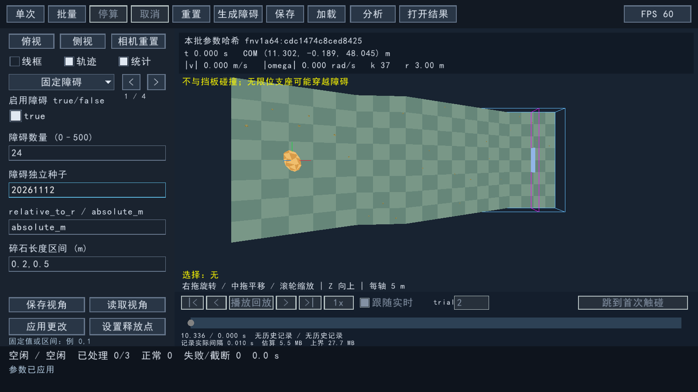

# 碎石分布与独立尺寸修复

2026-11-12，针对全坡分布、尺寸联动及默认过大过密三个反馈。此次设置取代旧演示的相对尺寸与释放走廊默认值，旧验收记录仍描述当时的 v1 版本。

## 原因与修改

- v1 自动范围横向只覆盖释放点附近，纵向截到挡板上游。把挡板放在 x=25m 时，实际12块碎石只落在 x=6.43～22.97m；整段地形长99.07m。v2 自动覆盖全坡面，沿下坡方向分段抽样，保留释放区和挡板附近的避让。相同夹具现覆盖 x=1.31～93.33m，横向最远18.14m。
- 原尺寸单位默认 `relative_to_r`，r=2时实际碎石最长1.59m、露出高最高0.80m。现在默认米制：24块，长宽0.20～0.50m、露出高0.06～0.18m、最小间距0.75m。每个ID的尺寸和朝向独立于位置重试，修改滚石不会重新缩放或重抽碎石尺寸。
- 凸体、碰撞材料、求解器和滚石随机流未改动。碎石仍可实际碰撞、偏转和停靠；不通过减小摩擦或禁用碰撞来提高通过率。

## 同种子真实试验

每组100次，r=2m、V=7m³，原地形及释放区不变，主seed=20261111、碎石seed=20261112，60秒上限。为减少测试文件，历史和普通轨迹行关闭，逐物理步统计继续运行。三组各100次正常完成，无失败或超时；滚石顶点和面文件的SHA256在三组之间完全一致。

| 场景 | 碎石数 | 碰到碎石的 trial | 最终 COM 位于坡脚或更下游 |
|---|---:|---:|---:|
| 修复前 v1 | 40 | 95/100 | 17/100 |
| 修复后 v2 | 24 | 58/100 | 45/100 |
| 关闭碎石对照 | 0 | 0/100 | 46/100 |

坡脚位置取实际地形 xFoot=79.0665656247m，表中统计最终COM.x≥xFoot，不等同于“曾经越过坡脚”的事件概率。这是固定种子的经验频率。无碎石时仍有滚石停在缓台或从侧边离开，因此不承诺所有滚石落到底部。

## 回归与兼容

`rs3d_obstacle_tests.exe --distribution` 通过实际 `SceneEditor::parse → freezeConfig` 编辑路径检查全坡分布、默认尺寸以及 r/V 从2/7改为3/20后的24块实际尺寸、体积与朝向；该回归在旧实现上明确失败。旧v1配置、输入与几何hash由修复前可执行程序固定为黄金值；新代码重新生成后保持一致。旧100次结果的trial1重新积分位置误差0，只读打开执行0次物理更新。

新场景保存 `placement=terrain`，manifest记录 `fixed-box-obstacles-v2`。缺少placement的旧INI保持v1；旧结果按对应算法校验实际几何。全部随附预设写明独立米制碎石参数，已有地形/初态参数不变。显式选择 `relative_to_r` 仍可按用户要求联动。

Release 18/18回归通过；Debug配置、批量重积分、碎石及档案事务4/4通过。九份随附预设均重新加载/保存成功。真实GUI输入r=3、V=20并应用，随后N=3两次预览后全部完成；输出24块碎石尺寸/朝向与原r=2、V=7的最大差为7.11×10⁻¹⁵，尺寸未联动。三次记录共4713帧，重开执行0次物理更新；旧包805帧样例也可只读打开。

证据文件位于 [evidence/obstacle-distribution-fix](evidence/obstacle-distribution-fix/summary.json)，包括三组统计、样本身份、失败/通过回归、Release/Debug检查和真实窗口记录。已有依赖缓存保持干净，三份原有工作区改动按初始SHA256保留。

