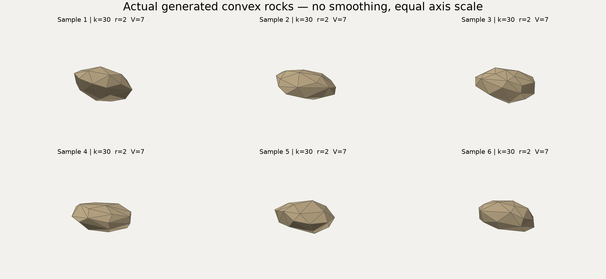

# RollingStone3D

RollingStone3D 三维首版：固定 r/V 的随机凸多面体、真实三维刚体、参数化地形/刚性挡板、场景编辑/拾取、两次实时预览加后台批次、路线概率 CSV 和数据重放均已实现。首版P0–P5验收与自然形状追加验证分别记录于 VALIDATION.md，交付记录见 PROGRESS.md。已有二维版保持独立。

使用现有 VS2022 C++ 工具链，不需要安装新编译器。在仓库根目录执行：

```powershell
./scripts3d/bootstrap.ps1
./build_3d.cmd
./test_3d.cmd
./run_3d.cmd
```

几何完整验收可运行 `test_3d.cmd --geometry-full`，顺序重跑先1100用户case、再补足5000样本；日志在`results3d/geometry_acceptance`。另用 `python scripts3d/audit_geometry.py results3d/geometry_acceptance`独立核对样本数、边界覆盖和记录误差。生产支持k10–100，默认20–50/r2/V7；k4–9仅为显式几何内核回归。当前使用凸包顶点内缩与各向形变的自然形状采样器（convex-retreat-com-radius-v3），仍不是所有定体积凸多面体上的均匀分布；最终5000样本中7个trial发生重试、0最终失败；0/5000不证明所有种子均成功。

生产支持域为 `10 <= k_min <= k_max <= 100`、`0.2 <= r <= 10 m`、`V/r^3 >= 0.02`，且 `V <= 0.9 * min(V_ref(k,r))`（对区间内所有k取最小值）。这里 `V_ref=(k-2)*sin(2*pi/(k-2))*r^3/3`，沿用首版的保守容量限制，不是所有球内多面体的数学体积上限；程序会拒绝范围外输入，不自动改变r/V。按用户确认的新定义，r为实体质心到最远顶点的距离，其他顶点允许位于球内；不是最小包围球半径。随机有间隔方向、保持极点的逐顶点内缩及各向形变生成不同棱角和长宽厚，再联合求解r/V。详见 [自然落石采样器说明](SHAPE_SAMPLER.md)。

新版规范几何使用实体质心为原点的double顶点和三角面，旧数据重放保留其原坐标系，闭合实体积分得到体积、COM与完整惯量张量。Jolt使用 `(顶点-COM)/r` 的零圆角凸形状，再以ScaledShape恢复米制；引擎float顶点/质量的误差单独读回校验。渲染以同一规范网格减去COM，使用实际Jolt形状原点和四元数变换，显示质心另取Jolt实际COM；二者不混淆。CSV保留规范顶点与变换，误差容差与5000样本实测值见VALIDATION。挡板直接由同一场景的有限盒生成，另从实际Jolt Body/BoxShape读回与显示网格核对。

核心验收入口还有`build/3d/bin/rs3d_physics_tests.exe`（D1-D7数值测试；可带D1等名称单测）及`rs3d_statistics_tests.exe results3d/dda_oracle.csv`。后者保存4000条线段计数，`python scripts3d/audit_dda.py`用独立的精确有理数求交复核，不依赖Jolt或图形。

`build_3d.cmd Debug` 编译Debug到 `build/3d/bin/debug`；Release到 `build/3d/bin`。`build_3d.cmd Release --core` 不读取或链接图形依赖。离线源码路径见DEPENDENCIES.md。

已可运行的无窗口入口（`--headless`不初始化图形窗口）：

```powershell
./run_3d.cmd --config configs3d/default.ini --batch 100 --seed 20261111 --preview 0 --headless
./run_3d.cmd --config configs3d/user_case_10_20_7_20.ini --single --headless
./run_3d.cmd --config configs3d/batch_throughput.ini --batch 1000 --headless
./run_3d.cmd --replay "results3d/run_实际目录" --trial 1 --headless
./run_3d.cmd --self-test
python scripts3d/audit_batch.py "results3d/run_实际目录"
```

配置为schema=1的UTF-8 INI，数值使用小数点；区间写成`lower,upper`，固定值写一个数。`--output`可覆盖输出根目录，支持中文/空格；Ctrl+C在完整物理步或生成迭代边界取消。每批使用独立目录；`.pending`与`INCOMPLETE.txt`表示事务未提交，不能使用其中的正式概率。写盘全部成功后才提交目录，`FILES_COMPLETE.txt`是文件完成清单，批次是否有效仍须看`manifest.ini`的status。

坐标为x下坡/y横向/z向上，单位m/s/kg。默认参数化坡面和支撑间隙0.05m，用户case释放x=20m；不以外包半径代替实体支撑高度。默认统计盒取地形末40m、全宽和坡脚中心高程上方10m；`toe_min`是显式替代基准，两者均不是局部离地高度。完整批概率为H/N；未进入统计区的正常试验仍在分母。任一最终失败/超时/取消使正式概率留空，诊断范围为[H/N,(H+N-C)/N]，不是置信区间。xy/xz按每次试验去重，不能相加三维概率。截面记录首次正向穿越，另列未穿越和首次穿越窗外。

同k最多64次构造尝试；重试成功只占一个trial，不重抽物性。最终失败保留槽位并继续原定编号，取消或I/O失败停止未开始项。manifest含源码内容SHA256、锁定依赖、配置hash、各计数和耗时；顶点/三角面/质心变换、实际姿态和地形CSV供独立重放。轨迹文件可降采样或关闭，但统计始终逐0.002s逻辑步执行，每步4个碰撞子步。投影、相机和显示帧率不能消费物理随机流。

`batch_throughput.ini`是专用水平面稳定基准：r2/V7/k20–50、e0、默认摩擦、零速度、零间隙、10s上限，显式`orientation=stable_face`将最接近质心的支撑面朝下。该夹具不改变采样几何或随机数，实际四元数写入输出；普通场景`orientation=sampled`保留采样姿态。随机姿态在10s内不一定满足连续2s静止，原失败基准也保存在VALIDATION。滚阻是按重量定标的接触切向角耗散，不含绕法线扭转阻力；空气阻力用pi*r²面积，均未作工程材料标定。

正式窗口使用顶部运行栏、左侧参数分页、中央三维视口、底部状态栏。操作步骤：

1. 从参数组选择地形，设置类型、宽度、横坡或沟槽，点击“应用更改”。各数值带单位；可输入固定数或 `lower,upper` 区间，枚举使用字段提示的 ASCII 文本。
2. 设置 k/r/V、密度、材料和初值。只有应用成功才替换场景；非法值保留供修改，字段附近和底部显示错误。改动尚未应用时不能启动运行。
3. 在明确的“设置释放点”模式下点选地形，填入世界 x/y 并计算实体支撑高度。也可数值编辑释放位置和间隙。
4. 可选启用挡板：有限宽度、高度、厚度、中心和绕 Z 方位角一起用于显示与刚体碰撞；`auto` 高度使底边落在覆盖区域最高支撑处。首版是静态刚性挡板。
5. “单次”使用屏幕上的独立预览样本；“重新随机”只改预览种子。正式“批量”要求 N>=2，重新按 master seed 采样，前两次按 1 倍模拟时钟播放，其余只更新进度。轨迹最多保留前两条的显示采样；概率仍逐物理步统计。
6. 运行和暂停时参数锁定。暂停/继续保留每一个物理步，重置先受控取消；取消或关闭等待工作线程安全收尾，状态与输出清单明确区分完整、失败、截断和取消。

视口右拖旋转、中拖平移、滚轮缩放；俯视、侧视和相机重置在左栏。左键拾取最近可见的落石、地形或挡板，空白取消；侧栏、文本编辑、菜单和模态对话框捕获自己的输入。实体/线框、轨迹、统计盒/截面开关均只影响显示。坐标轴每段5m；辅助轨迹和统计轮廓使用真实深度测试，会被实体遮挡。顶部显示 COM、速度/角速度模长和当前批次哈希。

“保存/加载”通过原生文件对话框处理 UTF-8 INI。加载先验证全部参数，失败保留原场景。相机“保存视角/读取视角”单独写入诊断目录的 `camera.ini`，不改变物理配置或种子。数值编辑不承诺中文输入法；路径支持中文和空格。FPS按钮循环60/30/不限，只改变绘制频率。

```powershell
./run_3d.cmd --config configs3d/with_barrier.ini
./run_3d.cmd --config configs3d/user_case_10_20_7_20.ini --single
./run_3d.cmd --config configs3d/batch.ini --batch 100 --seed 20261111 --preview 2
python scripts3d/audit_gui.py --output results3d/gui_matrix_new
./scripts3d/package.ps1 -Destination 'build/3d/package/new-release'
```

发布文件夹含exe、自检exe、配置、文档和依赖许可；`run_3d.cmd`在任意当前目录下切换到包目录启动。VS和第三方运行时DLL不属于运行前提，程序使用静态/MT依赖；系统OpenGL及Windows组件仍必需。字体不随包分发。`--self-test`需要随包的测试exe；完整5000几何验收使用仓库测试脚本。

`--ui-prototype`保留独立的预设运动观察原型，始终标记 preset motion，供显示负载复测，不产生物理概率。第6.5节时间轴回放、联动热图、方案对比和复杂桌面布局不属于首版。

字体默认读取本机 `C:/Windows/Fonts/simhei.ttf`，不随程序分发；可用 `--font "有权使用的中文字体.ttf"` 指定，路径支持中文及空格。

P0辅助检查：

```powershell
./scripts3d/audit_build.ps1
./run_3d.cmd --ui-self-test --output results3d/ui-self-test
./run_3d.cmd --render-check --output results3d/render-check
./run_3d.cmd --ui-prototype --benchmark --output results3d/benchmark
./run_3d.cmd --ui-prototype --capture --duration 20 --output results3d/capture
```

基准每场景预热5秒、采样30秒，重复3次；基准和压力各3轮，共约210秒。每0.5秒向实际相机控制器送入微小旋转指令来测软件响应，日志明确区分scripted_controller/native；不是操作系统或屏幕端到端延迟。`scripts3d/audit_prototype.ps1 -Results results3d/benchmark`检查六轮的帧时间、内存与软件响应预算。

`--capture` 是可选的真实帧缓冲诊断截图，会增加读回/写盘开销，不能与性能基准混用。测试结果目录和依赖缓存不提交。Computer Use窗口捕获有白屏或滞后现象，因此运行验收同时保存实际程序帧缓冲、原生输入日志，并说明哪些项目由控制器自动序列验证；详见VALIDATION。


真实运行性能诊断（每场景预热5秒、取样30秒、三轮；无截图开销）：

```powershell
./run_3d.cmd --config configs3d/with_barrier.ini --single --benchmark --fps 0 --evidence results3d/perf_preview --output results3d/perf_preview_runs
./run_3d.cmd --config configs3d/batch_throughput.ini --batch 10000 --preview 0 --benchmark --fps 0 --evidence results3d/perf_background --output results3d/perf_background_runs
python scripts3d/audit_performance.py results3d/perf_preview
python scripts3d/audit_performance.py results3d/perf_background
```

预览基准重复真实单次来覆盖整个取样时间，后台基准顺序推进真实数值批次；结束时受控取消未完成工作，因此可能返回退出码2并产生不完整概率，不能把它当作完整统计批。普通完成退出0，错误/失败退出1，受控取消退出2。性能门槛固定于P0，详见VALIDATION。


本机验收覆盖76,800个地形三角面、单个k<=100刚体、一个有限刚性挡板；显示压力负载为50条各2000点的静态轨迹，正式应用只保存前两条预览轨迹，后台不显示动画。不能据此推断可同时物理模拟50块石头。固定预算为帧P95<=33.334ms/P99<=50ms、峰值512MiB、软件响应P95<=50ms/最大250ms；最终真实预览/后台均通过。当前自然形状版稳定专用场景1000次43.39秒、零失败/超时，普通坡面结果仍按真实终止状态报告。

当前自然形状版的独立发行目录为`build/3d/package/RollingStone3D-natural`，双击其中的`run_3d.cmd`启动；源码入口仍是仓库根目录的同名命令。大体积发行包和结果未提交Git，换机器须按本文重建或复制发行目录，并提供有权使用的中文字体。真实输出示例在`results3d/natural_v3_final1000/run_20261112_084735_13532_1`；其中manifest、trials、voxel_probability、collector_yz和projection_xy/xz给出配置、状态与概率。


查看自然落石：`run_3d.cmd --config configs3d/natural_preview.ini`。这个12×12m平地场景便于观察形状；点击“重新随机”查看不同样本，默认坡面仍可正常使用。新旧采样器使用相同seed时形状会不同，旧结果请通过--replay读取实际顶点；完整运行身份包含manifest中的sampler和radius_definition，不能只凭参数hash混合统计。



新形状的部分支撑面在原Jolt接触归并设置下会对平面网格对角线敏感。当前保留完整接触流形，manifest记录`manifold_reduction=0`；旧CSV回放缺少此项时恢复旧设置，已验证旧/新结果回放位置误差均为0。该修复不改变dt、子步和静止判据，新增两种网格回归。Release/Debug均通过11项CTest，包括独立形态检查；新增图表是实际网格示例，不能作为地质形态标定。
