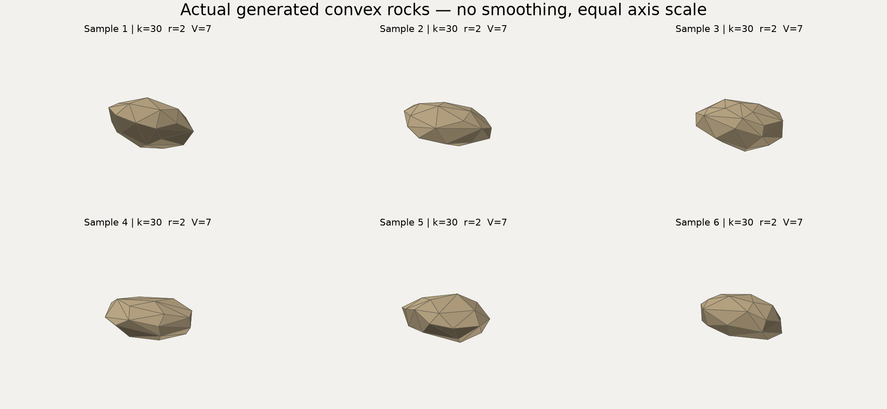

# 自然不规则落石：采样器 v3

2026-11-12，首版提交 d591a06 之后的用户追加要求。用户明确同意把“全部顶点共球面”改为“外包半径为 r、允许顶点在球内”。本说明替代原计划4.2的双锥生成方法及4.3的全部顶点等半径约束；不修改用户已有的计划文件。

## 当前参数含义

`r = max_i |vertex_i - solid_COM|`：以实体质心为中心，最远顶点距离恰为r，其余顶点在球内。这里没有计算最小包围球。`V`仍为闭合实体的实际体积，`k`仍为凸包顶点数，质量仍为rho*V，惯量仍从实际实体积分。显示与碰撞采用同一份形状，不用贴图或仅改变渲染外观模拟不规则性。

生产范围仍为k=10–100、r=0.2–10m、V/r³>=0.02，旧参考体积公式的90%上界继续作为保守输入限制。该公式不再是生成模板，也不是数学最大体积。小V/r³与固定最大半径并存时，形状必然较扁或细长；不能承诺任意r/V都得到饱满块石。

## 生成方法

1. 在整个单位球面生成随机候选，每次从24个候选中选离已有点最远者，得到有间隔的k个方向；没有固定两极、赤道环或预设面连接。
2. 随机顺序逐个调整顶点。计算其余k−1点的凸包，求该点向该凸包内部质心移动时穿过支撑面的边界；只走边界外的一部分距离。被移动点保持极点，凸包收缩也不会使其他顶点变成内点。
3. 每次调整检查按质心外包半径归一化的体积。如果不足以覆盖目标V，逐次减半该顶点的位移；保留体积求根的有效端点，不降低目标体积、不减少k。
4. 减去实体质心、随机选形变方向，应用可逆映射diag(1,t^a,t^(1−a))，a随机取0.15–0.85。每个候选都归一化到目标最大半径r；其体积由原体积、行列式t和归一化尺度计算，使用有界二分括区求解V。
5. 随机整体旋转，重新构造凸包、独立积分体积/质心/惯量，检查最大半径、完整k、闭合性、质量、零圆角Jolt读回及原数值容差。64次同k尝试预算和独立物性随机流保持不变。

这是带间隔选择、凸性约束和长宽厚变化的形状族，不是所有凸多面体上的均匀分布，也不是由现场扫描或岩石断裂数据标定的模型。各向伸缩与半径归一化联合求解V，不是先凑体积再悄悄改变r。

## 实际形状

下图来自实际生成的顶点和三角面，k=30、r=2m、V=7m³，seed由master_seed=20261112顺序派生。仅为比较外形作刚性旋转，各坐标轴等比例，未平滑或改动网格。



生成全部72个观察样本并重新绘图：

```powershell
build/3d/bin/rs3d_morphology_tests.exe results3d/shape_gallery_new
python scripts3d/render_shape_gallery.py results3d/shape_gallery_new --count 6 --name natural_rocks.png
```

绘图脚本使用本机已有numpy/matplotlib，仅为可选证据工具；应用与C++测试不依赖它们。

## 兼容与结果解释

manifest记录`sampler=convex-retreat-com-radius-v3`、`radius_definition=max_vertex_distance_from_solid_com`及允许球内顶点。同版本同seed仍可复现；与旧双锥版本使用相同seed时，形状和轨迹会改变，不能混用两版本的统计结果。配置哈希标识参数文本，完整运行身份还必须包含sampler和source_tree_sha256。

已有INI仍可读取，重新运行时使用新半径定义和新采样器。已有结果的`--replay`读取实际顶点/面及初态，不重新采样；旧数据不需要改写。滚阻回归已冻结旧版真实36顶点样本，避免更换随机形状后丢失原故障覆盖。

原型v2仅替换为球面分散点、仍保留立体投影，虽然数值通过，但实际图仍有明显球壳切块偏置，未作为本次交付方案。v3初次完整测试23个高体积边界样本耗尽重试，原记录保留；加体积端点回退后完整重测，详见VALIDATION中的本次追加记录。


## 不规则支撑面的接触处理

当前默认关闭Jolt的接触流形归并（`mUseManifoldReduction=false`），保留独立地形三角面提供的接触。实际稳定批中的325/850号样本在归并开启时超时，同一平面换对角线就能静止；关闭后两种对角线均2s静止。关闭滚阻、更换支撑面都未解决，不采用这些无效修改。此修复增加接触求解开销，最终1000次实测43.39s，仍满足900s预算，不能沿用旧版18.82s作新版性能。

新manifest写入`manifold_reduction=0`。回放读取此项；旧manifest没有该项时使用原来的true，保留历史轨迹复现。未改变碰撞子步、静止阈值、恢复/摩擦参数和滚阻公式。
